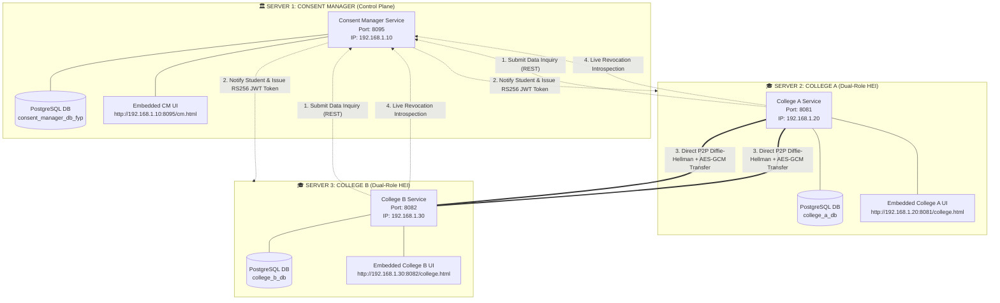

# 🌐 DEPA Multi-Server Production Deployment Guide
## Architecture & Deployment: Server 1 (CM) · Server 2 (College A) · Server 3 (College B)

---

### 1. Executive Summary & Architectural Overview

The DEPA (Data Empowerment and Protection Architecture) framework enforces strict **separation of concerns**:
- **Control Plane (Consent Manager):** Handles consent life-cycle, student authorization, consent grants, and RS256 asymmetric token signing. **CM never sees, stores, or transmits student academic records (100% Data Blindness).**
- **Data Plane (Colleges / Higher Education Institutions):** Transmits encrypted student records directly between institutions over peer-to-peer (P2P) channels using **Diffie-Hellman Ephemeral (DHE) Key Exchange + AES-GCM (256-bit) encryption**.
- **College Codebase Equivalence:** **College A and College B are the identical Spring Boot application artifact.** Both run the unified dual-role engine (`ORGANIZATION_A-main`) and configure their identity, database, and ports dynamically via environment variables.

---

### 2. Network Topology & System Architecture



---

### 3. Server Node Matrix & Environment Variables

| Parameter | Server 1: Consent Manager | Server 2: College A | Server 3: College B |
| :--- | :--- | :--- | :--- |
| **Physical / VM Host** | Server 1 (e.g. `192.168.1.10`) | Server 2 (e.g. `192.168.1.20`) | Server 3 (e.g. `192.168.1.30`) |
| **Source Project** | `Consent_Manager-master` | `ORGANIZATION_A-main` | `ORGANIZATION_A-main` *(Same code!)* |
| **Application Port** | `PORT=8095` | `PORT=8081` | `PORT=8082` |
| **Application Name** | `consent-manager` | `college-a-app` | `college-b-app` |
| **Institutional Code** | *N/A (Central Registry)* | `APP_COLLEGE_CODE=COLLEGE_A` | `APP_COLLEGE_CODE=COLLEGE_B` |
| **Institution Name** | *N/A* | `APP_COLLEGE_NAME="College A University"` | `APP_COLLEGE_NAME="College B University"` |
| **Consent Manager URL** | *Self (`http://localhost:8095`)* | `APP_CM_BASE_URL=http://192.168.1.10:8095` | `APP_CM_BASE_URL=http://192.168.1.10:8095` |
| **Internal Secret Key** | *N/A* | `APP_INTERNAL_API_KEY=A-INTERNAL-SECRET-KEY` | `APP_INTERNAL_API_KEY=B-INTERNAL-SECRET-KEY` |
| **Database Connection** | `jdbc:postgresql://<db1>:5432/consent_manager_db_fyp` | `jdbc:postgresql://<db2>:5432/college_a_db` | `jdbc:postgresql://<db3>:5432/college_b_db` |
| **Database User / Pass**| `postgres` / `root` | `postgres` / `root` | `postgres` / `root` |
| **Embedded Web UI** | `http://192.168.1.10:8095/cm.html` | `http://192.168.1.20:8081/college.html` | `http://192.168.1.30:8082/college.html` |

---

### 4. Deployment Option A: Multi-Server Deployment via Standalone JARs (Bare-Metal / Cloud VMs)

#### Step 1: Build the Production JARs
From the root workspace directory, package the applications:
```powershell
# Build Consent Manager JAR (Server 1)
mvn clean package -pl Consent_Manager-master -DskipTests

# Build Unified College JAR (Servers 2 and 3)
mvn clean package -pl ORGANIZATION_A-main -DskipTests
```
This produces:
- `Consent_Manager-master/target/consent-manager-1.0.0.jar`
- `ORGANIZATION_A-main/target/college-a-provider-0.0.1-SNAPSHOT.jar`

---

#### Step 2: Deploy Server 1 (Consent Manager)
Copy `consent-manager-1.0.0.jar` to **Server 1** (`192.168.1.10`):

**On Server 1 (Linux):**
```bash
export PORT=8095
export SPRING_DATASOURCE_URL=jdbc:postgresql://localhost:5432/consent_manager_db_fyp
export SPRING_DATASOURCE_USERNAME=postgres
export SPRING_DATASOURCE_PASSWORD=root
export APP_JWT_SECRET=404E635266556A586E3272357538782F413F4428472B4B6250645367566B5970

java -jar consent-manager-1.0.0.jar
```

**On Server 1 (Windows PowerShell):**
```powershell
.\deploy\run_server1_cm.ps1 -Port 8095 -DbUrl "jdbc:postgresql://localhost:5432/consent_manager_db_fyp"
```

---

#### Step 3: Deploy Server 2 (College A)
Copy `college-a-provider-0.0.1-SNAPSHOT.jar` to **Server 2** (`192.168.1.20`):

**On Server 2 (Linux):**
```bash
export PORT=8081
export APP_COLLEGE_CODE=COLLEGE_A
export APP_COLLEGE_NAME="College A University"
export APP_CM_BASE_URL="http://192.168.1.10:8095"
export APP_INTERNAL_API_KEY="A-INTERNAL-SECRET-KEY"
export SPRING_DATASOURCE_URL=jdbc:postgresql://localhost:5432/college_a_db
export SPRING_DATASOURCE_USERNAME=postgres
export SPRING_DATASOURCE_PASSWORD=root

java -jar college-a-provider-0.0.1-SNAPSHOT.jar
```

**On Server 2 (Windows PowerShell):**
```powershell
.\deploy\run_server2_college_a.ps1 -Port 8081 -CmUrl "http://192.168.1.10:8095" -DbUrl "jdbc:postgresql://localhost:5432/college_a_db"
```

---

#### Step 4: Deploy Server 3 (College B - Identical JAR!)
Copy the **exact same** `college-a-provider-0.0.1-SNAPSHOT.jar` to **Server 3** (`192.168.1.30`):

**On Server 3 (Linux):**
```bash
export PORT=8082
export APP_COLLEGE_CODE=COLLEGE_B
export APP_COLLEGE_NAME="College B University"
export APP_CM_BASE_URL="http://192.168.1.10:8095"
export APP_INTERNAL_API_KEY="B-INTERNAL-SECRET-KEY"
export SPRING_DATASOURCE_URL=jdbc:postgresql://localhost:5432/college_b_db
export SPRING_DATASOURCE_USERNAME=postgres
export SPRING_DATASOURCE_PASSWORD=root

java -jar college-a-provider-0.0.1-SNAPSHOT.jar
```

**On Server 3 (Windows PowerShell):**
```powershell
.\deploy\run_server3_college_b.ps1 -Port 8082 -CmUrl "http://192.168.1.10:8095" -DbUrl "jdbc:postgresql://localhost:5432/college_b_db"
```

---

### 5. Deployment Option B: Multi-Container Simulation via Docker Compose

To test the entire 3-server topology with isolated databases on a single host or orchestrator:

```bash
docker-compose up -d --build
```

This starts:
1. `depa-server1-cm` at `http://localhost:8095`
2. `depa-server2-college-a` at `http://localhost:8081`
3. `depa-server3-college-b` at `http://localhost:8082`
4. 3 distinct PostgreSQL containers with persistent volumes.

---

### 6. Client-Side Dynamic Endpoint Configuration

Each web UI contains an embedded, interactive **Network Configuration Modal**:
1. Click the **`⚙️ Server Endpoints`** button in the top header of either the Consent Manager UI or College Portal.
2. Enter the remote IP addresses or hostnames:
   - **Consent Manager:** `http://192.168.1.10:8095`
   - **College A:** `http://192.168.1.20:8081`
   - **College B:** `http://192.168.1.30:8082`
3. Click **"Save & Apply Endpoints"**.
4. The client will immediately store the endpoints in browser `localStorage` and ping all nodes across the network to verify real-time connectivity.

---

### 7. End-to-End Operational Verification Workflow

Once deployed on the 3 servers:
1. **Open Consent Manager:** Navigate to `http://<server-1-ip>:8095/cm.html`. Confirm active health indicators and 6 canonical fields.
2. **Open College Portal (College A as Consumer):** Navigate to `http://<server-2-ip>:8081/college.html`.
3. **Submit Inquiry ("Get Data from Other System"):**
   - Click **📥 Get Data from Other System**.
   - Click **⚡ Autofill Demo Request (Alice Johnson)**.
   - Provider: `COLLEGE_A` (or `COLLEGE_B`).
   - Select attributes: `CGPA`, `TRANSCRIPT`, `DEGREE_CERTIFICATE`.
   - Click **Submit Inquiry via Consent Manager**.
4. **Approve via Consent Manager (Student Principal):**
   - In CM UI, switch persona to **Alice Johnson (`STU-2023-001`)**.
   - Click **✅ Authorize & Sign Token**.
   - CM generates RS256 cryptographic grant `GRNT_xxxx` and signs the access token.
5. **Direct P2P Data Exchange & Decryption ("View Data from Other System"):**
   - Back in College Portal, click **⚡ Fetch & Decrypt P2P Data**.
   - College A Consumer directly contacts College B Provider (or vice-versa).
   - Generates Diffie-Hellman ephemeral keypair, transmits public key, receives AES-GCM ciphertext, and decrypts locally.
   - Automatically navigates to **👁️ View Data from Other System**, displaying the official embossed certificate with verified CGPA, Transcript, and Degree!
6. **Revocation Defense Test:**
   - In CM UI, click **Revoke Consent**.
   - In College Portal, click **🛡️ Test Provider Revocation Defense**.
   - Provider inspects live status with CM and blocks request with `403 Forbidden`!
